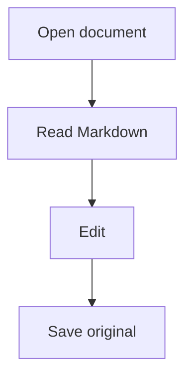

# MDHero on Android

Offline Markdown, using the original reader.

## Lists and links

- [x] Read a local document
- [ ] Save the original document
- Nested list
  - Child item

[Open the second document](second.md)


## Table

| Feature | Result | Details | A deliberately wide final column for horizontal scrolling |
| --- | --- | --- | --- |
| Reader | Original styling | Offline | Tables remain inside the phone viewport |
| Editor | UTF-8 | Save to source | The long column can scroll horizontally |

## Highlighted code

```typescript
const greeting: string = "Hello, Android";
console.log(greeting);
```

## Equations

Euler's identity: $e^{i\pi}+1=0$.

$$
\int_0^1 x^2\,dx = \frac{1}{3}
$$

## Mermaid



## Multilingual

مرحبا بالعالم — שלום עולם — 日本語 — Ελληνικά — 😀

> Markdown stays portable. Documents stay on the device.

## Reading position

First paragraph. Search should find the word **verification** here and in the title.

Second paragraph. Changing modes preserves the current document and its draft.

Third paragraph. Switching tabs preserves each document's reading position.

Fourth paragraph. Android Back returns to the reader, then to Home.

Fifth paragraph. Font and theme preferences persist across restarts.

Sixth paragraph. This document is accessible without a network connection.

## Security example

<script>alert('untrusted')</script>

[Unsafe scheme](javascript:alert('untrusted'))

## Final heading

The end of the verification document.
